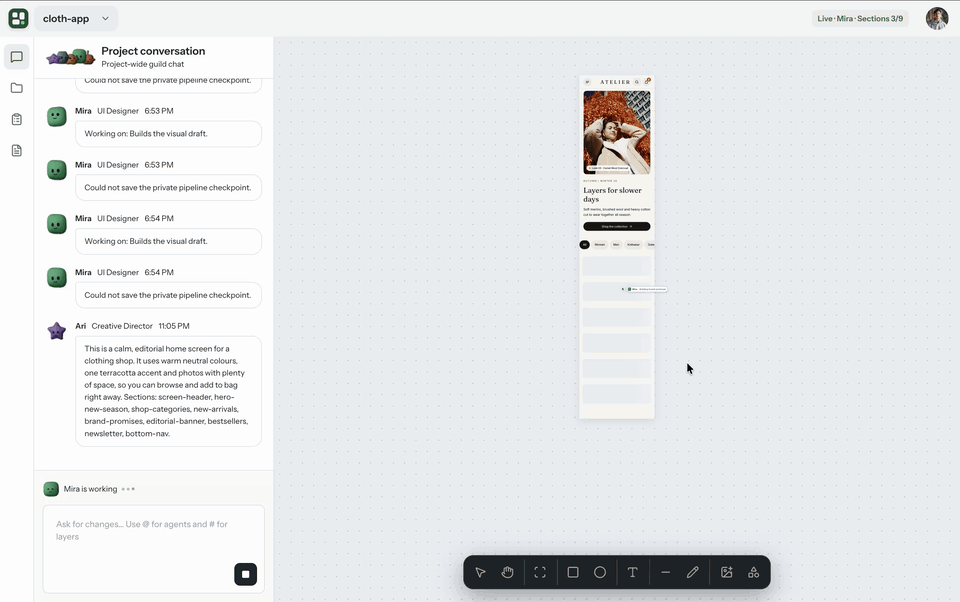
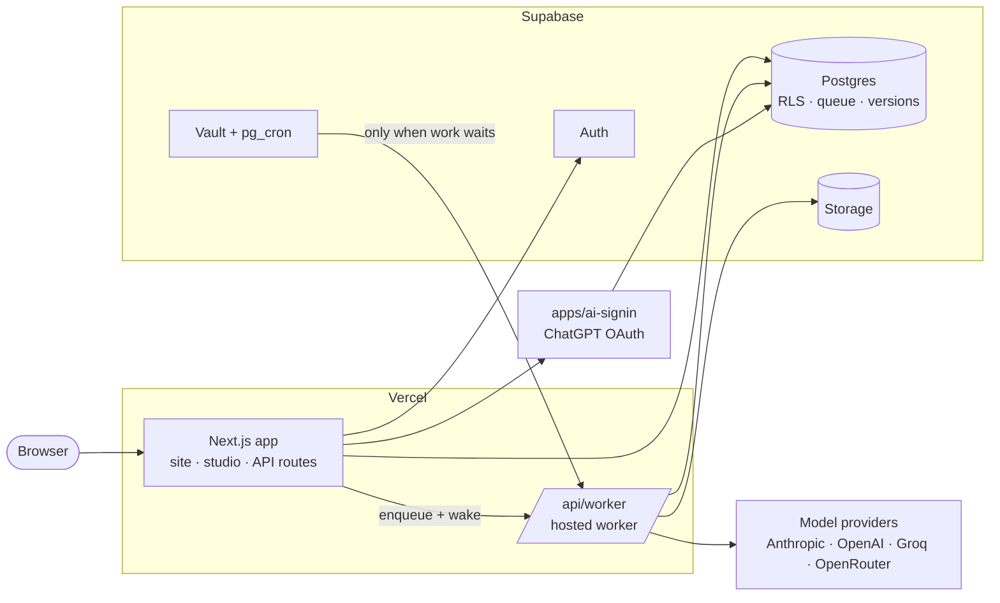

<div align="center">

<a href="https://www.guildos.design">
  
</a>

# GuildOS

**A guild of AI design agents that turns a brief into real, editable HTML screens, live on a shared canvas.**

[Website](https://www.guildos.design) · [Docs](docs/) · [Report a bug](https://github.com/S07K/guildos/issues/new?template=bug_report.yml) · [Request a feature](https://github.com/S07K/guildos/issues/new?template=feature_request.yml) · [Discussions](https://github.com/S07K/guildos/discussions)

<!-- Project status -->
[](LICENSE)
[](https://github.com/S07K/guildos/actions/workflows/checks.yml)
[](https://github.com/S07K/guildos/stargazers)
[](https://github.com/S07K/guildos/network/members)
[](https://github.com/S07K/guildos/issues)
[](https://github.com/S07K/guildos/pulls)
[](https://github.com/S07K/guildos/commits/main)
[](https://github.com/S07K/guildos/graphs/contributors)
[](https://github.com/S07K/guildos)
[](https://github.com/S07K/guildos/search?l=typescript)
[](CONTRIBUTING.md)
[](CODE_OF_CONDUCT.md)

<!-- Tech stack -->
[](https://nextjs.org/)
[](https://react.dev/)
[](https://www.typescriptlang.org/)
[](https://nodejs.org/)
[](https://supabase.com/)
[](https://tailwindcss.com/)
[](https://mui.com/)
[](https://vercel.com/)
[](https://playwright.dev/)
[](https://modelcontextprotocol.io/)

<br />



</div>

---

## Table of contents

- [About](#about)
- [Features](#features)
- [Tech stack](#tech-stack)
- [Architecture](#architecture)
- [Getting started](#getting-started)
- [Scripts](#scripts)
- [Testing](#testing)
- [Deployment](#deployment)
- [Documentation](#documentation)
- [Roadmap](#roadmap)
- [Contributing](#contributing)
- [Security](#security)
- [License](#license)
- [Acknowledgements](#acknowledgements)

## About

GuildOS is a design studio where a small team of specialist AI agents designs screens for you. You describe what you need; a **Creative Director** agent plans the screen and **UI Designer** agents build it as real **HTML + Tailwind**, section by section, while you watch it appear on an infinite board. Every screen can then be refined three ways: ask in chat (the whole screen, one section, or a new section), edit it by hand in a full-screen editor, or generate desktop, tablet and mobile versions. Every change is saved as a new version you can restore.

GuildOS is **bring-your-own-key**: you connect your own model provider and the keys are encrypted at rest. New workspaces can also try a few runs on a platform key.

Three design choices shape the system:

1. **Screens are HTML, not a proprietary node tree.** Model output is sanitised, compiled with Tailwind on the server and rendered in a sandboxed iframe, so what you see is what you export.
2. **Work is a durable queue, not a request.** A prompt becomes a task row in Postgres; workers lease it, checkpoint after every step and resume after a crash.
3. **The database is the referee.** Tenant isolation (row-level security), concurrency (leases, optimistic versioning) and publishing (atomic commit functions) are enforced in Postgres.

A deeper walkthrough with diagrams lives in [docs/system-design.md](docs/system-design.md).

## Features

**Design with agents**
- Section-by-section generation of mobile, tablet and desktop screens, built up to three sections at a time and shown live on the canvas.
- Scoped prompt edits: global edit, section edit, or add a section after the selected element.
- Generate device versions, alternative visual variations, or regenerate a screen from scratch.
- Reference images (pick, paste or drop up to four) passed to the agents as visual input.
- Project conversation with `@`-mentions of specialists, durable agent tasks and a workspace-wide task board (`/studio/tasks`) with stop, retry and approve.
- Optional image generation for screen photos with your OpenAI or OpenRouter key, plus Unsplash search with attribution.

**Edit and ship**
- Infinite board with pan/zoom, sticky notes, duplicate, remove and drag-to-arrange.
- Full-screen manual editor with a layer tree, style panel, inline text editing, blocks and undo/redo.
- Immutable version history with restore.
- Export a standalone HTML file with compiled CSS and inlined images, view the code, and preview by device.
- View-only share links for a screen or the whole board, revocable at any time.

**Models, keys and cost**
- Connect Anthropic (Claude), OpenAI, Groq or OpenRouter API keys, or a ChatGPT plan through the separate OAuth sign-in service.
- Keys are encrypted with AES-256-GCM, bound to the workspace and decrypted only in memory by the server and worker.
- Automatic fallback to the next connected provider on capacity or rate-limit errors.
- Token usage recorded on every version and message, with a per-day analytics page and cost estimates from a per-model price table.
- Free trial runs on a platform Groq or OpenRouter key for workspaces without a connection.

**Platform**
- Email-code and Google sign-in through Supabase Auth, one private workspace per account, and row-level security on every studio table.
- Hosted worker on Vercel (`/api/worker`) with a Supabase `pg_cron` backstop, or a long-running local worker (`npm run worker`).
- A local [Model Context Protocol](https://modelcontextprotocol.io/) server exposing the Lucide icon catalogue and Unsplash search (`npm run mcp:icons`).
- Marketing site and blog.

## Tech stack

| Layer | Technology |
| --- | --- |
| Framework | [Next.js 16](https://nextjs.org/) (App Router) · [React 19](https://react.dev/) · [TypeScript](https://www.typescriptlang.org/) |
| UI | [MUI](https://mui.com/) for the studio · [Tailwind CSS v4](https://tailwindcss.com/) for the marketing site and per-screen CSS · [GSAP](https://gsap.com/) · [Lucide](https://lucide.dev/) icons |
| Data & auth | [Supabase](https://supabase.com/): Postgres with RLS, Auth, Storage, Vault, `pg_cron` |
| AI | Anthropic SDK, OpenAI Responses API, Groq, OpenRouter, optional local Codex / Claude Code CLIs for development |
| Validation | [Zod](https://zod.dev/) |
| Hosting | [Vercel](https://vercel.com/) + GitHub Actions for migrate-then-deploy |
| Testing | Node.js test runner, [PGlite](https://pglite.dev/) for real SQL in tests, [Playwright](https://playwright.dev/) for studio browser tests |

## Architecture



### Repository layout

This is an npm workspaces monorepo. The root package is the main GuildOS app.

```text
.
├── src/
│   ├── app/                  # Next.js App Router: marketing site, /blogs, /signin, /studio, /share, API routes
│   │   └── api/              # /api/studio/* (session-authenticated) and /api/worker (bearer secret)
│   ├── components/           # Marketing components and studio UI (components/studio)
│   └── lib/
│       ├── auth/             # Supabase session helpers
│       ├── studio/           # Agents, worker, section pipeline, HTML sanitiser, vault, providers, usage
│       ├── exporters/        # Export helpers
│       └── marketing/        # Site and blog content
├── apps/ai-signin/           # Standalone Next.js service for ChatGPT plan OAuth (deployed separately)
├── packages/provider-auth/   # Provider OAuth contract shared with apps/ai-signin
├── scripts/                  # dev runner, agent worker, migration runner, icon MCP server
├── supabase/migrations/      # Ordered SQL migrations (schema, RLS, queue, functions)
├── tests/                    # Node test suites, fixtures and Playwright studio tests
├── docs/                     # Setup, deployment and design documents
└── public/                   # Static assets
```

Key source files: worker loop `src/lib/studio/agents/worker.ts`, section state machine `src/lib/studio/agents/section-pipeline.ts`, sanitiser and export `src/lib/studio/html-screen.ts`, vault `src/lib/studio/vault.mjs`, provider fallback `src/lib/studio/provider-fallback.ts`.

## Getting started

### Prerequisites

- **Node.js 24+** and npm
- A **Supabase** project for development (use a separate project from production)
- At least one model provider key (Anthropic, OpenAI, Groq or OpenRouter), or a trial key configured on the server
- Optional: an [Unsplash](https://unsplash.com/developers) access key for photo search, and Chromium for browser tests

### 1. Clone and install

```sh
git clone https://github.com/S07K/guildos.git
cd guildos
npm ci
```

### 2. Configure the environment

```sh
cp .env.example .env.local
```

Fill in at least:

| Variable | Description |
| --- | --- |
| `SUPABASE_URL` | Your Supabase project URL |
| `SUPABASE_SECRET_KEY` | Server-only Supabase secret key (legacy `SUPABASE_SERVICE_ROLE_KEY` also works) |
| `SUPABASE_PUBLISHABLE_KEY` | Supabase publishable key, used for studio authentication |
| `SUPABASE_DB_URL` | Postgres connection string; `npm run dev` applies pending migrations to it |
| `STUDIO_VAULT_KEY` | 32-byte hex key that encrypts provider keys: `openssl rand -hex 32`. Keep it stable and backed up |
| `STUDIO_APP_URL` | `http://localhost:3000` for local development |

Everything else in [`.env.example`](.env.example) is optional and documented inline (trial keys, model overrides, image models, Unsplash, the hosted worker secret, and the AI sign-in service). Never put a secret in a `NEXT_PUBLIC_` variable.

### 3. Set up Supabase

1. In **Authentication**, enable email sign-in and sign-ups, and change the **Magic Link** email template to include the one-time code, e.g. `Your GuildOS sign-in code is {{ .Token }}`. GuildOS verifies codes, not magic-link redirects. Configure SMTP before inviting other users.
2. Migrations in `supabase/migrations/` are applied automatically by `npm run dev` (via the Supabase CLI, pinned in `scripts/migrate.ts`). Run `npm run db:migrate` to apply them on demand, or set `STUDIO_SKIP_MIGRATIONS=1` to skip.

See [docs/studio-setup.md](docs/studio-setup.md) for the complete guide, including ChatGPT, Claude and trial connections.

### 4. Run it

```sh
npm run dev
```

This applies pending migrations, then starts the web app on [http://localhost:3000](http://localhost:3000), the local AI sign-in service on `127.0.0.1:8787`, and the agent worker. Open `/signin`, request a code, then add a model connection under **Studio → Connections** and create your first project.

## Scripts

| Command | What it does |
| --- | --- |
| `npm run dev` | Apply migrations, then run the app, the AI sign-in service and the agent worker |
| `npm run worker` | Run the agent worker on its own |
| `npm run db:migrate` | Apply pending Supabase migrations to `SUPABASE_DB_URL` (refuses to run on Vercel/CI) |
| `npm run mcp:icons` | Start the local MCP server for Lucide icons and Unsplash search ([docs](docs/icon-mcp.md)) |
| `npm run build` | Production build of the main app |
| `npm start` | Serve the production build |
| `npm run typecheck` | TypeScript check (`tsc --noEmit`) |
| `npm test` | Node test suites |
| `npm run test:studio` | Playwright studio browser tests |
| `npm run audit:all` / `audit:production` | Dependency audit (all / runtime only) |
| `npm run verify` | Tests, build, audit and browser tests |

## Testing

```sh
npm run typecheck
npm test
```

The Node suites apply the full migration chain to [PGlite](https://pglite.dev/) to test real PostgreSQL semantics for tenant isolation, locking and replays; cover the key vault cryptography; and use mocked provider responses for the agent pipeline.

Browser tests run against a localhost Supabase fixture with no auth bypass in the app:

```sh
npx playwright install chromium
npm run build
npm run test:studio
```

To use an existing Chromium or Chrome binary, set `PLAYWRIGHT_EXECUTABLE_PATH`. CI ([`.github/workflows/checks.yml`](.github/workflows/checks.yml)) runs the typecheck, tests, build, browser tests and dependency audits on every push and pull request.

## Deployment

GuildOS is designed for **Vercel + Supabase**:

- Pushes to `main` run the checks workflow; once they pass, a production job builds the revision, applies pending Supabase migrations and deploys the prebuilt output to Vercel. `vercel.json` disables Vercel's own Git deploys for `main` so a release can never run ahead of its migrations. Required secrets are listed in [docs/deployment.md](docs/deployment.md).
- On Vercel, agent work runs in short `/api/worker` invocations, with a Supabase `pg_cron` backstop. See [Hosted worker](docs/studio-setup.md#hosted-worker-production-no-extra-server).
- The optional ChatGPT sign-in service in `apps/ai-signin` is deployed as its own Vercel project. See [docs/ai-signin-service.md](docs/ai-signin-service.md).

## Documentation

| Document | Topic |
| --- | --- |
| [system-design.md](docs/system-design.md) | Whole-system walkthrough with diagrams |
| [studio-setup.md](docs/studio-setup.md) | Local setup, connections, hosted worker, trial |
| [deployment.md](docs/deployment.md) | Production migrations and Vercel deployment |
| [ai-signin-service.md](docs/ai-signin-service.md) | ChatGPT OAuth service |
| [section-pipeline-redesign.md](docs/section-pipeline-redesign.md) | Section-based generation pipeline |
| [agent-worker.md](docs/agent-worker.md) | Agent worker |
| [canvas-commands.md](docs/canvas-commands.md) | Canvas command model |
| [studio-exports.md](docs/studio-exports.md) | Export formats |
| [icon-mcp.md](docs/icon-mcp.md) | Icon and image MCP server |

## Roadmap

Planned and not yet built (from [docs/system-design.md](docs/system-design.md#13-not-built-yet-keep-off-the-how-it-works-slides) and [docs/agent-workspace-roadmap.md](docs/agent-workspace-roadmap.md)):

- [ ] Flows and prototype links between screens
- [ ] Comments on screens
- [ ] Workspace-level conversations and direct messages with specialists
- [ ] Saved task-board views, priorities and due dates
- [ ] Design-system import
- [ ] Figma / Webflow export
- [ ] Shared vector memory across projects
- [ ] Team workspaces, invitations, roles and enterprise SSO
- [ ] Publishing to a custom domain

Have an idea? Open a [feature request](https://github.com/S07K/guildos/issues/new?template=feature_request.yml) or start a [discussion](https://github.com/S07K/guildos/discussions).

## Contributing

Contributions are welcome! Please read [CONTRIBUTING.md](CONTRIBUTING.md) for the development workflow, branch naming (`feat/`, `fix/`, `chore/` …), [Conventional Commits](https://www.conventionalcommits.org/) and review process. All changes land through pull requests approved by the code owner.

Please follow our [Code of Conduct](CODE_OF_CONDUCT.md). For help, see [SUPPORT.md](SUPPORT.md).

## Security

Please **do not** report vulnerabilities in public issues. Use [GitHub private vulnerability reporting](https://github.com/S07K/guildos/security/advisories/new); see [SECURITY.md](SECURITY.md) for details.

## License

GuildOS is licensed under the [GNU Affero General Public License v3.0](LICENSE) (`AGPL-3.0-only`). If you run a modified version of GuildOS as a network service, the AGPL requires you to make the corresponding source code available to its users.

Copyright © 2026 S07K and GuildOS contributors.

## Acknowledgements

GuildOS is built on the shoulders of excellent open-source projects and services, including [Next.js](https://nextjs.org/), [React](https://react.dev/), [Supabase](https://supabase.com/), [Tailwind CSS](https://tailwindcss.com/), [MUI](https://mui.com/), [GSAP](https://gsap.com/), [Lucide](https://lucide.dev/), [Zod](https://zod.dev/), [PGlite](https://pglite.dev/), [Playwright](https://playwright.dev/) and the [Model Context Protocol](https://modelcontextprotocol.io/) SDK. Stock photography is provided through the [Unsplash API](https://unsplash.com/developers).

<div align="center">
<sub>If GuildOS is useful to you, consider giving it a ⭐</sub>
</div>
