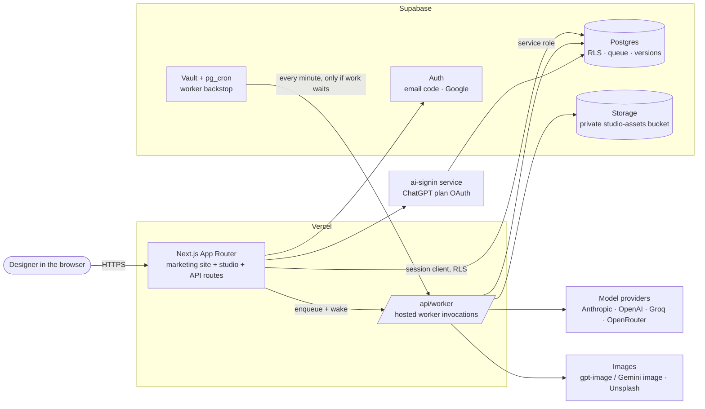
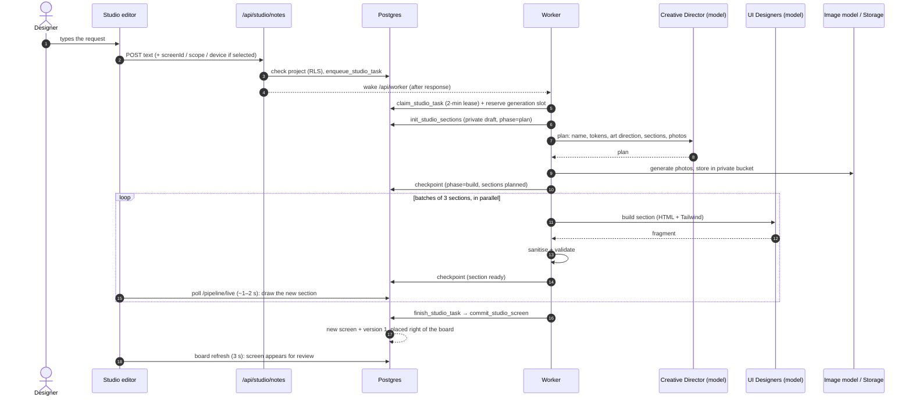
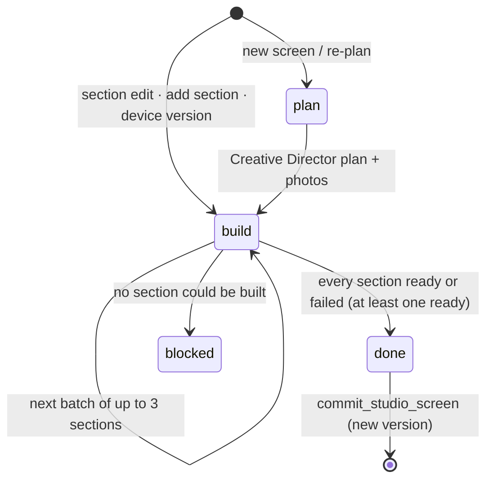
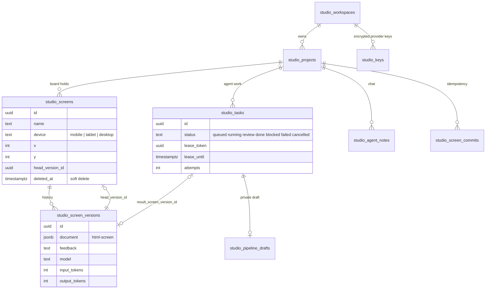
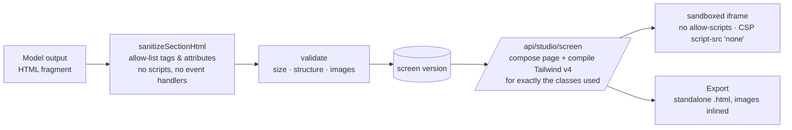
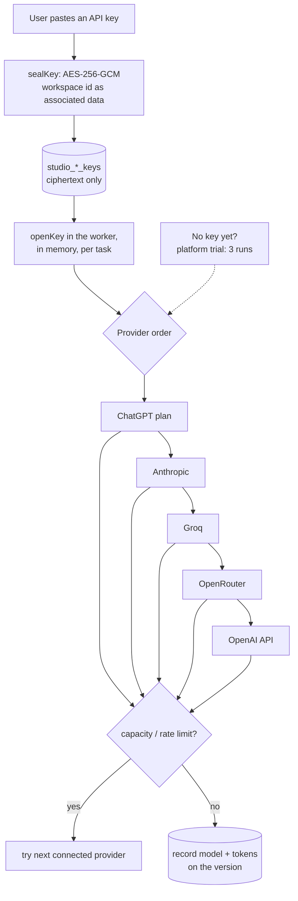
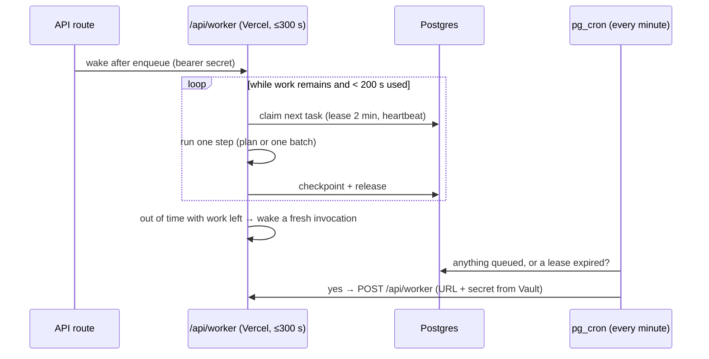

# GuildOS — System Design (and video script)

**As of:** 2026-11-12, checked against the code on `feat/trial-and-conversion`.
**What it covers:** the whole app: sign-in and workspaces, the credential vault, the task
queue and worker, the agent pipeline that designs HTML screens section by section, the
board editor, safety, cost tracking and deployment.
**How to use it:** every diagram is a Mermaid block. Paste it into
[mermaid.live](https://mermaid.live) (export SVG/PNG) or into Excalidraw → *Mermaid to
Excalidraw* to restyle it. §14 is the video package: the beats, a voiceover script, b-roll
and the claims to avoid.

| # | Diagram | Section |
|---|---|---|
| 1 | System context | §2 |
| 2 | One request, end to end (sequence) | §4 |
| 3 | Section pipeline state machine | §5 |
| 4 | Data model | §6 |
| 5 | Rendering and safety | §7 |
| 6 | Providers, vault and fallback | §9 |
| 7 | Hosted worker and its backstop | §10 |

---

## 1. The idea in one breath

You describe a screen. A small team of AI agents (a Creative Director who plans, UI
Designers who build) designs it as real HTML + Tailwind, **section by section, live on a
canvas**. Every screen lands on a board you can edit three ways: ask in chat (the whole
screen, one section, or a new section), edit by hand in a full-screen editor, or ask for a
desktop/tablet/mobile version. Every change is a new version you can restore.

Three design choices carry the whole system:

1. **The screen is HTML, not a proprietary node tree.** Models are very good at HTML and
   Tailwind; GuildOS sanitises it, compiles the CSS on the server and renders it in a
   sandboxed iframe. What you see is what you export.
2. **Work is a durable queue, not a request.** A prompt becomes a task row in Postgres.
   Workers lease it, checkpoint after every step, and any crash resumes from the last
   checkpoint.
3. **The database is the referee.** Tenant isolation (row-level security), concurrency
   (leases, optimistic versioning) and publishing (atomic commit functions) are enforced in
   Postgres, so the web app and the worker cannot disagree.

---

## 2. System context — Diagram 1

**Pieces**

| Piece | What it does |
|---|---|
| Next.js app (`src/app`) | Marketing site and blog, the studio UI (`/studio/*`), and every API route. Node.js runtime. |
| Worker (`src/lib/studio/agents/worker.ts`) | Claims a task, runs one step of a pipeline, checkpoints, releases. Runs as short Vercel invocations (`/api/worker`) in production, or as `npm run worker` locally. |
| Supabase Postgres | Tenancy, projects, the task queue, private drafts, screens and versions, keys (encrypted), usage. All critical state changes are SQL functions. |
| Supabase Storage | Generated and uploaded images, in a private bucket under `workspace/project/…`. |
| ai-signin (`apps/ai-signin`) | A separate small app that runs the OAuth flow for a ChatGPT plan and keeps those credentials encrypted. |
| Model providers | Text models for planning and building; image models for screen photos. |
| MCP server (`npm run mcp:icons`) | A local Model Context Protocol server exposing the Lucide icon catalogue and Unsplash search as tools. |

**Stack:** Next.js (App Router) + React + TypeScript, MUI for the studio chrome,
Tailwind v4 (both for the site and compiled per screen), Supabase (Auth, Postgres,
Storage, Vault, pg_cron), Vercel, Playwright and Node's test runner (with PGlite for real
SQL in tests).

---

## 3. Accounts, workspaces and tenant isolation

- **Sign-in:** a 6-digit email code or Google, through Supabase Auth.
- **Workspace:** each user owns a workspace; projects, keys, tasks, screens and assets all
  carry `workspace_id`.
- **Row-level security:** every studio table has RLS. Browser-facing reads use the
  user's session client, so Postgres itself filters to the caller's workspace.
- **Writes go through checked doors:** API routes first confirm, with the session client,
  that the project is the caller's; only then do they call a `security definer` SQL
  function or the service-role client, always passing both `project_id` and
  `workspace_id`. Functions are revoked from `anon`/`authenticated` where only the server
  may call them.
- **Same-origin writes:** mutating routes reject requests whose `Origin` is not the studio.
- **Storage paths are tenant-scoped:** `workspace/project/asset`, served back only through
  `/api/studio/assets/:id` after the same project check.

---

## 4. One request, end to end — Diagram 2

The user selects nothing and types *"A home screen for a linen clothing shop."*

**Notes for the narration**

- The user's request returns immediately; the work is a row in `studio_tasks`.
- Every model call is followed by a **checkpoint** (`checkpoint_studio_sections`). The
  checkpoint compares the previous state, so two workers can never both write.
- The live canvas reads the **private draft** (`studio_pipeline_drafts`), not a
  published version. Nothing reaches the board until `finish_studio_task` commits it.
- The agent cursor on the canvas ("Building hero…", "Drawing product-list") is derived
  from that draft.

---

## 5. The section pipeline — Diagram 3

**Where a request goes** is decided by invisible markers the API appends to the
instruction (`guildos-screen`, `guildos-scope`, `guildos-device`). The user never sees them.

| User action | Markers | Pipeline starts at | Result |
|---|---|---|---|
| Prompt with nothing selected | none | plan (styled like the newest screen) | a **new screen** to the right of the board |
| Prompt with a screen selected (Global edit) | screen | plan (with that screen as the previous design) | a new version of that screen |
| Element selected → Section edit | screen + section | build (only that section) | new version, one section rewritten |
| Element selected → Add section | screen + add-after | build (one new section) | new version with a section inserted |
| Generate ▾ Desktop / Tablet / Mobile version | screen + device | build (every section, *adapt* mode) | a **new screen beside the source**, same content and photos |
| Generate ▾ Variations | screen + variation (1, 2) | plan (look only), then build the source's sections | a **new screen** with a different palette, fonts and style, same sections and photos |

**Rules worth saying out loud**

- Sections build **3 at a time in parallel**; checkpoints are applied one at a time
  against the latest state.
- A failed section is retried once (2 attempts), then marked failed on the screen; the
  screen still publishes if at least one section is ready.
- Device versions **skip the plan**: each section is adapted from its mobile markup, and
  the art direction and photos are reused, so a desktop version costs only build calls.
- Limits: 24 sections per screen, 64 KB of HTML per section, 6 photos per screen.

---

## 6. Data model — Diagram 4

**The screen document** (`kind: "html-screen"`): `name`, `device`, `background`, design
`tokens` (colours, fonts), `art` (direction, style recipes, photos) and an ordered list of
`sections`, each `{ id, kind, intent, status, html }`.

**Versioning rules**

- `commit_studio_screen` is the only way a version is written. It takes the
  **expected head version**; if someone else saved first it returns `conflict` instead of
  overwriting (optimistic concurrency).
- Each commit carries a `request_id`; replaying the same request returns the same version
  (`studio_screen_commits`), so a retried network call never double-saves.
- Restoring an old version saves it as a **new** version. History is never rewritten.
- Removing a screen sets `deleted_at`; its versions stay.

Other tables: `studio_versions` (older node-canvas and landing-page projects),
`studio_agent_messages` (direct chats with one agent), `studio_generation_limits` (one
generation slot per workspace), `studio_trial_runs`, and one table per provider key type.

---

## 7. Rendering and safety — Diagram 5

- **Allow-list sanitiser** (`src/lib/studio/html-screen.ts`): unknown tags and every
  `on*` attribute are dropped; inline styles pass only through a CSS property allow-list;
  links cannot point at `javascript:`.
- **Server-side Tailwind:** each screen gets a fresh Tailwind v4 compile of the classes it
  actually uses, with its tokens as theme variables. No CDN script ever runs.
- **Sandbox + CSP:** the canvas iframe has no `allow-scripts`, and the document carries
  `default-src 'none'; script-src 'none'` with images limited to the app and Unsplash.
  Clicks are hit-tested by an overlay in the parent page, so links never navigate.
- **Export** produces one self-contained HTML file with the compiled CSS and project
  images inlined as data URIs.

---

## 8. Editing on the board

| Mode | How | What is saved |
|---|---|---|
| Select | click a screen; click inside it to pick an element; drag a title to move | position via `PATCH /api/studio/screens` |
| Prompt edit | the chat shows the selection as a chip; choose Section edit, Add section or Global edit | a new screen version from the agents |
| Manual Edit (⌥M) | full-screen editor: layer tree, style panel, inline text editing, blocks, undo/redo, device widths | `POST /api/studio/screens` → new version (sanitised again on the server) |
| Generate ▾ | Variations (2 alternative looks) · Desktop / Tablet / Mobile version | new screens on the board |
| More ▾ | Version history with Restore; Duplicate; Remove screen | restore = new version; duplicate = new screen; remove = soft delete |
| Copy / Export, Code, Preview | standalone HTML, code view, device preview | nothing |

An empty project keeps a freeform canvas (shapes, text, images) until its first screen
exists; from then on it is a board.

---

## 9. Providers, vault, trial and cost — Diagram 6

- **Bring your own key:** keys are encrypted the moment they arrive (AES-256-GCM, a fresh
  IV per key, the workspace id bound in as associated data so a ciphertext cannot be moved
  to another workspace). Only the server and worker decrypt, in memory, per task. The UI
  only ever sees a key's last four characters.
- **Plan sign-in:** a ChatGPT plan connects through the separate `ai-signin` service
  (OAuth with PKCE); its credentials are stored encrypted too.
- **Fallback:** the worker tries connected providers in a fixed priority order and moves
  on only for capacity or rate-limit failures; any other error stops the task with a clear
  message.
- **Free trial:** a new workspace gets 3 runs on a platform key (Groq or OpenRouter),
  admitted atomically by `claim_studio_trial_run`. The key never leaves the server.
- **Cost:** every version and agent message records model, input and output tokens. The
  analytics page sums them per day and estimates cost from a per-model price table
  (`src/lib/studio/usage.mjs`); unknown models are shown as unpriced, never guessed.
- **One generation at a time per workspace:** `reserve_studio_generation` gives each
  workspace a single renewable slot, so one account cannot flood the providers.

---

## 10. Hosted worker and its backstop — Diagram 7

- Vercel has no always-on process, so the queue is drained by short invocations. Each
  step holds a **lease with a heartbeat**; if an invocation dies mid-step, the lease
  expires and the next invocation resumes from the last checkpoint.
- A task whose lease expires 3 times is failed instead of looping forever.
- The **pg_cron backstop** runs every minute but only calls the worker when work is
  actually waiting. Its URL and secret live in Supabase Vault, not in the migration.
- Locally, `npm run dev` starts the app, the ai-signin app and a worker process, after
  applying pending migrations.

---

## 11. The older node-canvas pipeline

Projects created before HTML screens hold a node-based canvas. Work on those still runs a
**five-stage pipeline** with a structured JSON contract per stage: Structure (UX Architect
"Noor") → Direction (Creative Director "Ari") → UI (UI Designer "Mira") → Copy
(Copywriter "Pip") → QA (QA Critic "Vale"). Each stage's schema allows only its own kind of
change (for example, Copy may touch only text nodes), and a stage hands off after at most 8
actions. New projects use the HTML section pipeline above; keep this pipeline out of the
main video, or mention it as "how it started".

---

## 12. Failure and recovery

| What breaks | What happens |
|---|---|
| Worker killed mid-step | lease expires (2 min); next invocation resumes from the last checkpoint |
| Two workers grab the same task | the claim is atomic; a stale checkpoint returns `stale` and the loser stops |
| Model returns bad HTML | sanitised; if invalid, the section is retried once, then marked failed |
| Every section fails | the task is blocked with a message; nothing is published |
| Provider rate-limited | next connected provider, noted in the conversation |
| No provider connected | the brief is parked and resumes when a model is connected |
| User saves while the agents work | optimistic version check: the later commit gets `conflict`, nothing is overwritten |
| Network retry of a save | same `request_id` returns the same version |
| User presses Stop | task cancelled and its lease cleared; the worker notices within seconds and stops; nothing is published, and Retry can queue it again |
| Image generation fails | fall back to an Unsplash photo, then a neutral placeholder |

---

## 13. Not built yet (keep off the "how it works" slides)

Regenerate, flows/prototype links between
screens, comments, publish/share links, UX review, design-system import, Figma/Webflow
export, shared vector memory across projects, enterprise SSO and team roles.

---

## 14. Video package

### 14.1 Format

- **Main cut:** 7–9 minutes, 16:9, for YouTube. **Short cut:** 60 seconds, 9:16 (§14.7).
- One diagram per beat. Start each diagram empty and build it up in the order the
  narration names the parts.

### 14.2 Visual system

- Dark background, one accent colour per agent (Ari purple, Mira green, the rest neutral).
- Boxes: rounded, 1 px strokes. Databases as cylinders. Async arrows dashed.
- Use real screen recordings for the product beats and diagrams for the system beats.

### 14.3 The beats

| # | Beat | On screen | Diagram |
|---|---|---|---|
| 0 | Hook | a screen drawing itself, section by section | screen recording |
| 1 | What GuildOS is | the board with several screens | — |
| 2 | The big picture | browser → Next.js → Supabase → worker → models | 1 |
| 3 | A prompt becomes a task | the queue row appears; the request returns | 2 (steps 1–4) |
| 4 | Plan, then build | Creative Director plan; 3 sections at a time | 2 (5–11), 3 |
| 5 | Why it never loses work | leases, checkpoints, private draft | 2, 7 |
| 6 | Where things go | markers table: new screen, section, device | 3 + table |
| 7 | The data model | screens and versions, optimistic commits | 4 |
| 8 | Safe HTML | sanitiser, server Tailwind, sandbox | 5 |
| 9 | Your keys, your costs | vault, fallback, trial, analytics | 6 |
| 10 | Serverless worker | invocations + pg_cron backstop | 7 |
| 11 | Close | the board, Manual Edit, a desktop version appearing | screen recording |

### 14.4 Voiceover script

**0 · Hook.** "This screen is being designed right now by a team of AI agents, one
section at a time. Here's how the system behind it works."

**1 · What it is.** "GuildOS is a design studio where specialist agents design real UI.
You describe a screen; it lands on a board. You can edit it by chatting, by hand, or ask
for a desktop version."

**2 · Big picture.** "There are four parts. A Next.js app on Vercel for the UI and APIs.
Supabase for auth, the Postgres database and file storage. A worker that runs the agents.
And the model providers: Claude, GPT, Groq or OpenRouter, using your own keys."

**3 · A prompt becomes a task.** "When you hit send, nothing waits on the AI. The API
checks you own the project and writes a task row into Postgres. The request returns
instantly, and the worker is woken up."

**4 · Plan, then build.** "The worker leases the task. First the Creative Director plans
the screen: the name, colours and fonts, an art direction, the list of sections, and the
photos to generate. Then UI Designers build the sections in HTML and Tailwind, three at a
time, in parallel. Each one appears on your canvas as soon as it's done."

**5 · Never lose work.** "After every model call, the worker saves a checkpoint to a
private draft. If the worker dies halfway, its lease expires and the next one carries on
from the last checkpoint. You only see the result on your board when the whole screen is
committed."

**6 · Where requests go.** "The same pipeline handles every kind of edit. Nothing
selected? A new screen. A screen selected? Re-plan it. An element selected? Rebuild just
that section. And a desktop version skips planning entirely: each section is adapted from
the mobile one, reusing the same photos."

**7 · Data model.** "A project is a board of screens, and each screen has its own version
history. Every save says which version it started from, so if two edits race, the second
gets a conflict instead of silently overwriting. Restoring an old version just saves it
again as the newest."

**8 · Safe HTML.** "Letting a model write HTML sounds risky, so there are three layers.
An allow-list sanitiser strips scripts and event handlers. Tailwind is compiled on the
server for exactly the classes used. And the screen renders in a sandboxed iframe where
scripts can't run at all."

**9 · Keys and costs.** "Your API keys are encrypted the moment they arrive, bound to your
workspace, and only decrypted in memory while a task runs. If a provider is rate-limited,
the worker falls back to your next one. Every call records its tokens, so the analytics
page shows exactly what you spent. New workspaces get three free runs to try it."

**10 · Serverless worker.** "On Vercel there's no always-on server, so the queue is
drained by short function runs. And once a minute, Postgres itself checks whether work is
waiting and, if so, wakes the worker up."

**11 · Close.** "Prompt to screen, live, durable and safe. That's GuildOS. Links below."

### 14.5 B-roll to capture

1. A new project: type a prompt, watch the plan arrive and sections draw in with the agent cursor.
2. The board with 3–4 screens; drag one by its title.
3. Select an element → chat chip → Section edit → only that section redraws.
4. Generate ▾ Desktop version → a desktop screen builds beside the mobile one.
5. Manual Edit: layer tree, change a font size, inline text edit, undo, save.
6. More ▾ Version history → Restore.
7. Connections page (blur the key suffixes) and the analytics page.
8. Code view and Download HTML; open the exported file in a browser.

### 14.6 Accuracy guardrails

- Say "agents" for the Creative Director (plan) and UI Designers (build). The five-role
  pipeline belongs to older canvas projects (§11); don't present it as today's flow.
- Don't claim real-time collaboration, comments, publishing, Figma export or shared memory
  across projects: not built (§13).
- The live canvas **polls** (about every 1–2 seconds); don't call it websockets.
- The Claude Code and Codex sign-ins are local-development conveniences, not product
  features. Don't show them as ways customers connect.
- Never show real keys, the worker secret, `.env` files or your email on screen.

### 14.7 60-second cut

1. (0–5 s) A screen draws itself. "AI agents are designing this, live."
2. (5–20 s) Diagram 1, fast build. "Next.js, Supabase, a worker, your own model keys."
3. (20–35 s) Plan → 3 sections in parallel → checkpoints. "Crash halfway? It resumes."
4. (35–50 s) Section edit, then Generate desktop version. "Edit one section, or get the desktop version."
5. (50–60 s) Sandbox + vault badges. "Sandboxed HTML. Encrypted keys. That's GuildOS."

---

## 15. Appendix

### API surface (studio)

| Route | Purpose |
|---|---|
| `POST /api/studio/notes` | chat message; queues agent work with screen/section/device scope |
| `GET /api/studio/pipeline/live` | the running task's private draft for the live canvas |
| `GET/POST/PATCH /api/studio/screens` | board list · save a screen version · move/rename/remove |
| `GET /api/studio/screens/versions` | one screen's version history |
| `POST /api/studio/screen` | compose a screen into a sandboxed page or a standalone export |
| `POST /api/studio/assets`, `GET /api/studio/assets/:id` | upload and serve project images |
| `GET/POST /api/studio/tasks` | task list; stop, retry, approve |
| `POST /api/studio/agents/:role/messages` | direct chat with one agent |
| `/api/studio/connections/*` | provider connections (ChatGPT plan, local Claude Code) |
| `POST /api/worker` | drain the queue (bearer secret) |
| `POST /api/studio/versions`, `/api/studio/canvas/*`, `/api/studio/generate` | older node-canvas projects |

### Key source files

| Area | File |
|---|---|
| Worker loop | `src/lib/studio/agents/worker.ts` |
| Section state machine | `src/lib/studio/agents/section-pipeline.ts` |
| Plan and build prompts | `src/lib/studio/agents/section-agents.ts` |
| Photos | `src/lib/studio/agents/screen-images.ts` |
| Screen document, sanitiser, markers, export | `src/lib/studio/html-screen.ts` |
| Tailwind compile | `src/lib/studio/html-screen-css.ts` |
| Board loading | `src/lib/studio/screens.ts` |
| Hosted worker | `src/lib/studio/agents/hosted-worker.ts`, `src/app/api/worker/route.ts` |
| Vault | `src/lib/studio/vault.mjs` |
| Provider calls and fallback | `src/lib/studio/agents/provider-request.ts`, `src/lib/studio/provider-fallback.ts` |
| Trial | `src/lib/studio/trial.ts` |
| Cost estimates | `src/lib/studio/usage.mjs` |
| Editor | `src/components/studio/project-editor.tsx`, `board-view.tsx`, `html-screen-frame.tsx`, `manual-editor.tsx`, `screen-toolbar.tsx` |
| Screens schema | `supabase/migrations/202611110002_studio_screens.sql` |
| Queue and leases | `supabase/migrations/202610160008_studio_agent_job_queue.sql` |
| Worker backstop | `supabase/migrations/202611100001_studio_worker_schedule.sql` |

### Glossary

- **Board:** a project's screens laid out on an infinite canvas.
- **Screen version:** an immutable snapshot of a screen document.
- **Private draft:** the in-progress state of a running task, invisible to the board until committed.
- **Lease:** a short, renewable claim on a task by one worker.
- **Checkpoint:** an atomic save of the draft after each model call.
- **Marker:** an invisible tag on a request that tells the worker which screen, section or device it targets.
- **RLS:** Postgres row-level security; the database filters every query to the caller's workspace.
